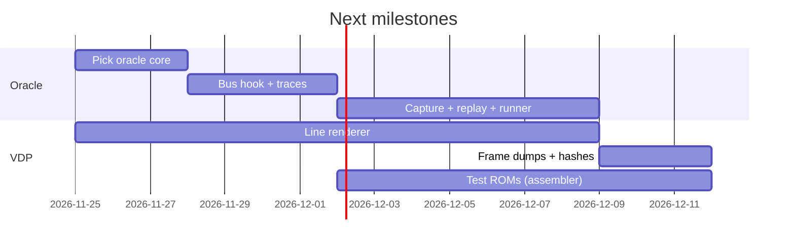

# Milestone details (2026-11-24)

## Next: oracle and VDP rendering (in parallel)

### Oracle (milestone 2, second half)

- Choose the 68000 oracle: Musashi + a Z80 core with our own bus, or patched Genesis Plus
  GX. Check whether BlastEm can emit bus traces (unverified).
- Bus hook producing `docs/trace-format.md` lines, filtering instruction fetches/prefetch.
- Breakpoint capture to `.nmds` state files; sentinel return address; final-state dump.
- Side-effect read replay into the candidate.
- Per-routine suite runner (state files in, pass/fail out).
- Lives in its own directory/repo; GPL code stays out of the engine.

### VDP (milestone 4)

- Line renderer: planes A/B, window, sprites with per-line limits, line/cell scroll,
  priority, shadow/highlight. Feeds `present_frame`.
- Headless frame dump (PNG or raw) and image hashes for whole-game comparison.
- Own test ROMs for DMA, fill/copy byte order, FIFO-visible behaviour, sprite limits.
  These need real 68000 code: pick an assembler (vasm / AS / asm68k).
- Verify the open points from the contract: fill/copy byte order, `TAS` write-back,
  word access to 8-bit devices, `MOVE.L` halves order.

## Then

- **Z80 (5)**: coroutine with its own clock, `z80_wait_*`, Z80 routine table, VBlank IRQ,
  write path through the 68000 window.
- **Sound (6)**: PSG then YM2612; compare write sequences; audio checked against Nuked-OPN2
  and jt12 (references only, GPL).
- **Controllers / saves / pacing (11)**: 6-button pad, mouse, multitap; battery SRAM chip
  via `nmd_chip`; NTSC/PAL frame pacing in the host.
- **Sonic 1 (8)**: start from a disassembly that reassembles bit-perfect; move leaf routines
  to C one by one, each with a green harness suite; routines without C run on the oracle.
- **Contract 1.0**: freeze once Sonic 1 runs as C.

## Decompilation workflow (reference)

- Start from the user's own dump. Header at `$100-$1FF`, vectors at `$0`.
- Ghidra / IDA / Binary Ninja; reassemble (vasm, AS, asm68k) and check the hash.
- Separate code from data with emulator execution traces (BlastEm, Exodus, MAME).
- The Z80 driver is usually a blob copied to Z80 RAM: disassemble it separately.
- Compressed data: Nemesis, Kosinski, Enigma, Saxman.
- Traps: jump tables, code copied to RAM, bank-switching mappers (SSF2).
- ASM → C routine by routine, by hand, with decompiler output as a hint only. A model
  may propose the C; **the harness decides**.

