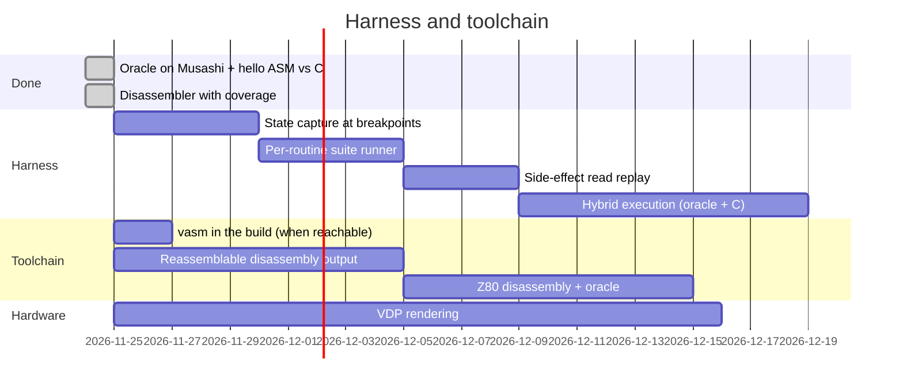

# Oracle and tools (2026-11-24, later the same day)

Decisions taken after the first plan of the day: MIT license; Musashi as the 68000
oracle, running the original code on the engine's own hardware model; vasm as the
assembler for test ROMs (not available in this environment yet). The oracle, a state diff
tool and a disassembler with coverage-guided code/data separation are done, and `hello`
passes the ASM-vs-C check.

What this changes in the plan:

- Milestone 2 (harness) moves ahead of the VDP renderer: the remaining harness pieces
  (state capture while playing, suite runner, side-effect replay, hybrid execution) are
  what Sonic 1 needs first.
- The decompilation toolchain is now part of the project: `nmd-disasm` grows into the
  ASM level (symbols, data/code split from oracle coverage, reassemblable output), and the
  oracle provides the coverage.

