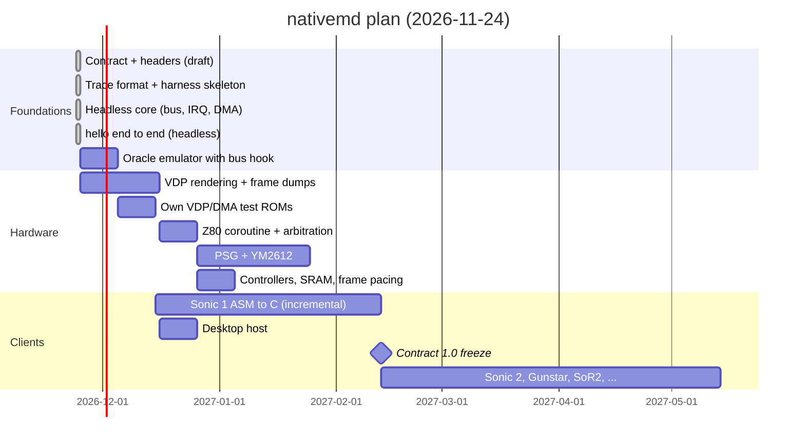

# nativemd — plan (2026-11-24)

## Goal

A **reusable engine**: a native implementation of the Mega Drive (not an emulator) that
the C of game decompilations links against.

- Inspiration: nativeshvc (SNES), from its README only. It is AGPL-3.0: take design ideas,
  **copy no code**.
- Central idea: the game provides the processors (68000 and Z80) as C; the engine provides
  everything else (bus, clock, VDP, DMA, interrupts, audio, controllers, saves, frame pacing).
- Fidelity promise: **behaviour-exact, not cycle-exact** (`docs/contract.md`).
- Preservation levels:
  1. **ASM**: source that reassembles to the ROM byte for byte.
  2. **C**: C source with the same behaviour, running on the engine.
  3. **Enhanced**: improved C (unlocked 60 Hz, widescreen, ...), built on top of the C level,
     not in its place.

## What carries over from SNES

- Processors in the game, everything else in the console.
- The sound Z80 plays the role of the SPC700: C against a machine model (`z80_rd/wr`,
  explicit waits). Many drivers are SMPS-like.
- The VDP is simpler than the SNES PPU (no Mode 7 or colour math), so it is easier to get exact.

## Risks and hard parts

- **YM2612** (DAC, SSG-EG, timers) and the SN76489 PSG.
- **VDP**: per-line sprite limits, FIFO, DMA, mid-line effects, shadow/highlight.
- **68000/Z80 bus**: arbitration and the Z80 bank window into the 68000 bus.
- **68000**: 16-bit accesses, address errors, prefetch (not reflected in C). Policy fixed in
  the contract draft.
- **Validation**: much less test material than for SNES; we write our own test ROMs.
- **Real bottleneck**: most Mega Drive projects (Sonic 1/2/3&K, ...) are ASM disassemblies,
  not C. Turning 68000 code into structured C is the big job; without C decompilations the
  engine has no users, so a real client game is always needed.

## Design decisions (this plan)

- Core in **C11 with CMake** (simplest for others to link). Rust with a C ABI stays as an
  alternative but is not pursued.
- Host isolated behind `host.h`: time, saves, window, input, audio. Null (headless) host
  first, desktop host later.
- Single thread, deterministic scheduling; game code in a coroutine; the Z80 in its own
  coroutine with its own clock.
- No C for an address → explicit fatal error, never a silent fallback.
- Unmapped bus accesses are fatal.

## Milestones

| # | Milestone | State |
|---|---|---|
| 1 | `contract.md` + headers (`machine.h`, `z80.h`, `hw.h`, `cart.h`, `host.h`); 68000 policy | draft done |
| 2 | Trace format and harness skeleton | format + tools done; oracle to do |
| 3 | Headless core: bus, clock, interrupts, DMA | first version done |
| 4 | VDP rendering + frame dumps; own test ROMs | to do |
| 5 | Z80 coroutine + bus arbitration | memory/arbitration done; scheduling to do |
| 6 | PSG + YM2612, validated against Nuked-OPN2 and jt12 | to do |
| 7 | `hello` end to end | done (headless, no image yet) |
| 8 | Real client: Sonic 1 (ASM → C, incremental with the harness) | to do |
| 9 | Desktop host (window, audio, controllers) | to do |
| 10 | Sonic 2, Gunstar Heroes, Streets of Rage 2, ... | to do |
| 11 | Cartridge connector: SRAM, mappers, future expansions | connector API done; chips to do |

Milestone details: [milestones.md](milestones.md). Test game ladder: [test-games.md](test-games.md).

