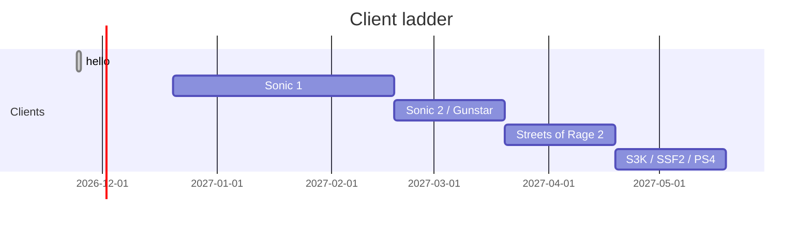

# Test game ladder (2026-11-24)

From memory; confirm which disassemblies are complete and reassemble bit-perfect today.
Games are tested with the user's own dumps; no ROMs or assets enter this repository.

| Step | Game | What it exercises |
|---|---|---|
| 0 | Own `hello` ROM | Minimal contract |
| 1 | Sonic the Hedgehog | Bus, basic VDP, Z80/SMPS, per-line palette (water), Nemesis/Kosinski |
| 2 | Sonic 2, Gunstar Heroes | Double-resolution interlace; many sprites, line scroll, mid-screen effects |
| 3 | Streets of Rage 2 | Demanding Z80, YM2612 DAC PCM, bus arbitration |
| 4 | Sonic 3 & Knuckles, Super Street Fighter II, Phantasy Star IV | SRAM, lock-on, SSF2 mapper |
| 5 | Titan Overdrive (community demo) | Extreme VDP tricks (check distribution terms) |

Other candidates: Thunder Force IV, Road Rash, Ristar (VDP); Contra: Hard Corps (FM + PSG +
PCM). Community VDP FIFO/DMA/timing test ROMs (e.g. from Exodus), current state unverified.

Oracle layers: software emulators (daily work, 68000 bus traces); Nuked-OPN2 and jt12 for
the YM2612; MiSTer cores (FPGAGen VDP, FX68K/TG68K, T80) under Verilator per block, at a
pinned commit. None of them is absolute truth; licences checked per module; no code copied.

