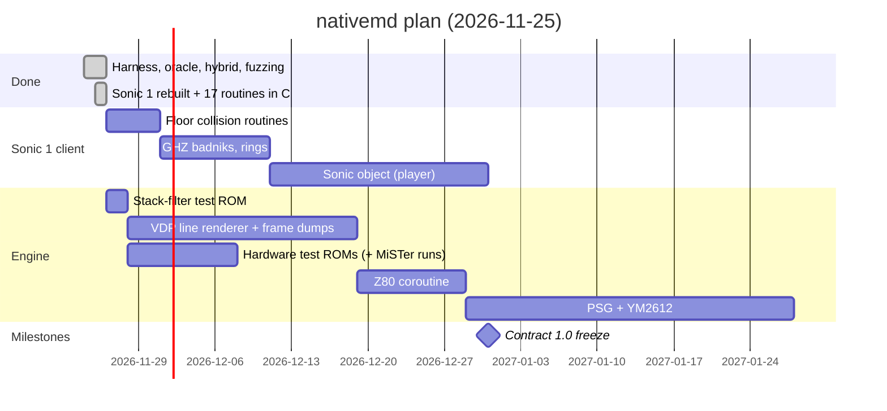

# nativemd — plan (2026-11-25)

Supersedes `ROADMAP/2026-11-24/`. History: `RECORD/2026-11-24.engine-bootstrap.completed.md`.

## Where we are

| Milestone (2026-11-24 numbering) | State |
|---|---|
| 1 Contract + headers | draft 0.1; several hardware points still "to verify" |
| 2 Trace format + harness | done: oracle, suites, replay, hybrid, fuzzing, lag detection |
| 3 Headless core | done (bus, interrupts, DMA, I/O, Z80 area) |
| 4 VDP rendering + test ROMs | **not started** |
| 5 Z80 scheduling | memory/arbitration done; coroutine not started |
| 6 PSG + YM2612 | not started |
| 7 `hello` end to end | done, including ASM vs C on the oracle |
| 8 Sonic 1 client | **in progress** (private repository): 17 routines in C, all verified |
| 9 Desktop host | not started |
| 10 More games | not started |
| 11 Cartridge connector | API done; SRAM / mappers not started |

## Decisions in force

- Behaviour-exact, not cycle-exact; lag frames are outside the contract.
- Game C lives outside this repository; engine changes it needs land here first.
- Every routine that gets C gets a suite: captured + fuzzed + edge states, plus the
  hybrid-with-C vs hybrid-without-C comparison.
- Harness filters (stack, idle loops, lag) must be proven not to hide real data.

## Next

1. **Sonic 1 client** (`nativemd-internal`, see its roadmap): floor collision
   (ObjFloorDist / FindFloor / FindNearestTile), then the Green Hill badniks, rings, and
   Sonic's own object.
2. **Harness**: a test ROM proving the stack filter hides only stack accesses; optional
   per-routine cost model (lag) left for later.
3. **VDP rendering** (milestone 4): line renderer, frame dumps and hashes; needs an
   assembler for test ROMs (vasm or AS, from user-provided sources).
4. **Hardware facts** in the contract: own test ROMs; confirmation on a MiSTer (user runs
   them, reports the screen or SRAM) and/or Verilator simulation of MiSTer cores (GPL, as an
   external oracle in the private repository).
5. **Z80 coroutine, then PSG/YM2612** (needed for Sonic's sound driver to run as C).

