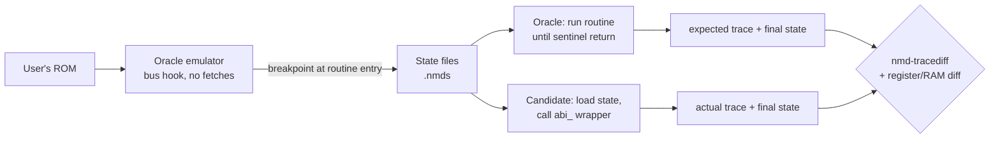

# Verification harness

The harness decides whether a routine's C is correct. A model or a person may propose
the C; **the harness decides**.

The oracle is the original ROM running on an instrumented emulator. A routine's C is
accepted when, from the same starting state, it makes the same data accesses to the bus,
in the same order, and leaves the same declared output registers and memory.

## Pipeline

1. **Capture**: on the oracle, break at the entry of a routine and save the machine state
   (registers, RAM, VRAM, CRAM, VSRAM, VDP registers, Z80 RAM) as a state file. Collect
   many real states per routine by playing; then fuzz inside valid ranges.
2. **Run the oracle**: load the state, push a sentinel return address, run until it is
   reached. Record the trace and the final state.
3. **Run the candidate**: `nmd_state_load`, call the routine's `abi_` wrapper with tracing
   on, then save the final state.
4. **Compare**: traces with `nmd-tracediff`; declared output registers; RAM/VRAM/CRAM/VSRAM.
5. **Side-effect reads** (VDP ports, controllers): the oracle's read values are recorded and
   replayed to the candidate in order. *(Replay mode: to do.)*
6. **Incremental migration**: routines without C still run on the oracle, so the hybrid
   game always works. A routine joins the C build only with its suite green. Start with
   leaf routines.
7. **Z80 / audio**: compare the ordered writes to the YM2612 and PSG.
8. **Whole game**: scripted input, per-frame dumps of VRAM/CRAM/VSRAM/RAM and image hashes.

## State files (`.nmds`, version 1)

Big-endian. Implemented by `nmd_state_save` / `nmd_state_load` (`src/state.c`).

| Offset | Size | Field |
|---|---|---|
| 0 | 4 | magic `NMDS` |
| 4 | 2 | version (1) |
| 6 | 2 | reserved |
| 8 | 32 | D0-D7 |
| 40 | 32 | A0-A7 |
| 72 | 2 | SR |
| 74 | 2 | padding |
| 76 | 65536 | 68000 RAM |
| 65612 | 65536 | VRAM |
| 131148 | 128 | CRAM (64 words) |
| 131276 | 80 | VSRAM (40 words) |
| 131356 | 24 | VDP registers |
| 131380 | 8192 | Z80 RAM |

Version 2 will add VDP port latches, I/O and Z80 bus state as the engine grows.

## Oracle choice (open)

Candidates: Musashi plus a Z80 core with our own bus (full control over the hook), or a
patched Genesis Plus GX. Whether BlastEm can produce bus traces is unverified. The oracle
lives outside the engine and is only used for comparison; GPL code must not be copied into
the engine.

## Status

| Piece | State |
|---|---|
| Trace format, writer, parser, `nmd-tracediff` | done |
| State files | done (v1) |
| Golden-trace regression test (`tests/hello`) | done |
| Oracle emulator with bus hook | to do |
| Capture at breakpoints, sentinel return | to do |
| Side-effect read replay | to do |
| Per-routine suite runner | to do |
