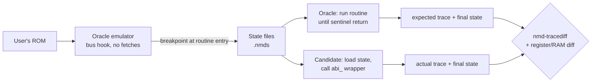

# Verification harness

The harness decides whether a routine's C is correct. A model or a person may propose
the C; **the harness decides**.

The oracle is the original ROM running on an instrumented emulator. A routine's C is
accepted when, from the same starting state, it makes the same data accesses to the bus,
in the same order, and leaves the same declared output registers and memory.

## Pipeline

1. **Capture**: on the oracle, break at the entry of a routine and save the machine state
   (registers, RAM, VRAM, CRAM, VSRAM, VDP registers, Z80 RAM) as a state file. Collect
   many real states per routine by playing; then fuzz inside valid ranges.
2. **Run the oracle**: load the state, push a sentinel return address, run until it is
   reached. Record the trace and the final state.
3. **Run the candidate**: `nmd_state_load`, call the routine's `abi_` wrapper with tracing
   on, then save the final state.
4. **Compare**: traces with `nmd-tracediff`; declared output registers; RAM/VRAM/CRAM/VSRAM.
5. **Side-effect reads** (VDP ports, controllers): the oracle's read values are recorded and
   replayed to the candidate in order. *(Replay mode: to do.)*
6. **Incremental migration**: routines without C still run on the oracle, so the hybrid
   game always works. A routine joins the C build only with its suite green. Start with
   leaf routines.
7. **Z80 / audio**: compare the ordered writes to the YM2612 and PSG.
8. **Whole game**: scripted input, per-frame dumps of VRAM/CRAM/VSRAM/RAM and image hashes.

## State files (`.nmds`, version 1)

Big-endian. Implemented by `nmd_state_save` / `nmd_state_load` (`src/state.c`).

| Offset | Size | Field |
|---|---|---|
| 0 | 4 | magic `NMDS` |
| 4 | 2 | version (1) |
| 6 | 2 | reserved |
| 8 | 32 | D0-D7 |
| 40 | 32 | A0-A7 |
| 72 | 2 | SR |
| 74 | 2 | padding |
| 76 | 65536 | 68000 RAM |
| 65612 | 65536 | VRAM |
| 131148 | 128 | CRAM (64 words) |
| 131276 | 80 | VSRAM (40 words) |
| 131356 | 24 | VDP registers |
| 131380 | 8192 | Z80 RAM |

Version 2 will add VDP port latches, I/O and Z80 bus state as the engine grows.

## Oracle: `nmd-oracle`

Musashi (MIT, `third_party/musashi`) runs the ROM's original 68000 code; the **nativemd
hardware model** sits behind it. The oracle therefore checks the CPU side: real 68000
semantics against the hand-written C, on identical hardware. The hardware model is
validated separately (own test ROMs, other emulators, MiSTer cores).

- **Frames mode** (`--frames N`): reset, then NTSC line timing (262 lines × 3420 master
  clocks, 68000 at /7). The VDP raises HINT per line and VINT at the end of active display;
  the run stops right after the `RTE` of the N-th VINT handler, the point where the engine's
  `nmd_run_frames(N)` stops.
- **Routine mode** (`--state S --call ADDR [--irq]`): load a state, push a sentinel return
  address (or an exception frame for an interrupt handler) and run until it returns.
- **Trace filters**: instruction fetches (Musashi's immediate reads) are not traced;
  PC-relative reads are. The vector fetch of an interrupt and accesses to the stack range
  (default: the 1 KB below the initial SSP, `--stack`) are dropped, because the C does not
  reproduce exception frames, `JSR`/`RTS` traffic or register saves.
- **Idle loop** (`--idle LABEL`): repeated identical reads inside the declared polling
  loop are collapsed, matching the collapsing of `wait_until` reads on the C side.
- **Corrections to Musashi**: `CLR` to memory performs its read cycle (Musashi omits it;
  the 68000 does it). `TAS` does not write back (Mega Drive bus).
- `--coverage FILE` lists executed instruction addresses, for `nmd-disasm --coverage`.

Musashi does not model the 68000's bus-cycle details beyond this (prefetch, exact
`MOVE.L` half order, `MOVEM` order). Those stay "to verify" in the contract and need other
references (hardware, FX68K).

## Tools

| Tool | Purpose |
|---|---|
| `nmd-oracle` | run original code, emit trace / state / coverage |
| `nmd-tracediff` | compare traces |
| `nmd-statediff` | compare state files (RAM ranges can be ignored; registers on request) |
| `nmd-disasm` | 68000 disassembler (Musashi's); symbols; coverage-guided code/data split |

## The hello example

`tests/hello` has the three levels of one program: `hello.s` (68000 source, encoded by
`tools/mkhello.c`, checked by disassembly against `hello.lst`), `hello_game.c` (the C) and
the ROM image. CTest checks that the oracle running the ROM and the engine running the C
produce the same trace (342 accesses over 10 frames) and the same final state, and that a
single routine (`VInt`) gives the same trace from the same captured state.

## Status

| Piece | State |
|---|---|
| Trace format, writer, parser, `nmd-tracediff` | done |
| State files, `nmd-statediff` | done (v1) |
| Oracle on Musashi: frames and routine modes, filters | done |
| End-to-end check on `hello` (ASM vs C) | done |
| Disassembler with coverage | done (first version) |
| Breakpoint capture of many states per routine while playing | to do |
| Side-effect read replay | to do |
| Per-routine suite runner | to do |
| Hybrid execution (routines without C run on the oracle) | to do |
| Z80 in the oracle | to do |
