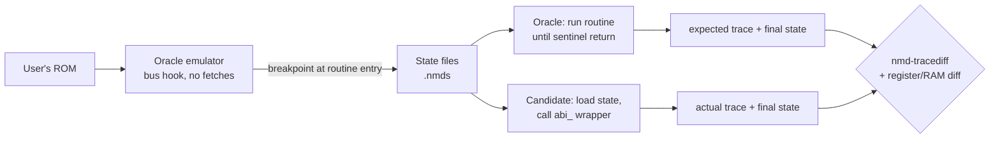

# Verification harness

The harness decides whether a routine's C is correct. A model or a person may propose
the C; **the harness decides**.

The oracle is the original ROM running on an instrumented emulator. A routine's C is
accepted when, from the same starting state, it makes the same data accesses to the bus,
in the same order, and leaves the same declared output registers and memory.

## Pipeline

1. **Capture**: on the oracle, break at the entry of a routine and save the machine state
   (registers, RAM, VRAM, CRAM, VSRAM, VDP registers, Z80 RAM) as a state file. Collect
   many real states per routine by playing; then fuzz inside valid ranges.
2. **Run the oracle**: load the state, push a sentinel return address, run until it is
   reached. Record the trace and the final state.
3. **Run the candidate**: `nmd_state_load`, call the routine's `abi_` wrapper with tracing
   on, then save the final state.
4. **Compare**: traces with `nmd-tracediff`; declared output registers; RAM/VRAM/CRAM/VSRAM.
5. **Side-effect reads** (VDP ports, controllers): the oracle's read values are recorded and
   replayed to the candidate in order. *(Replay mode: to do.)*
6. **Incremental migration**: routines without C still run on the oracle, so the hybrid
   game always works. A routine joins the C build only with its suite green. Start with
   leaf routines.
7. **Z80 / audio**: compare the ordered writes to the YM2612 and PSG.
8. **Whole game**: scripted input, per-frame dumps of VRAM/CRAM/VSRAM/RAM and image hashes.

## State files (`.nmds`, version 2)

Big-endian. The layout is documented at the top of `src/state.c`. Besides CPU registers,
RAM, VRAM, CRAM, VSRAM, VDP registers and Z80 RAM (version 1), version 2 stores the
latches a routine can depend on: VDP command/address/pending flags/HINT counter, I/O
data and control registers and pad state, Z80 bus request/reset/bank, YM2612 address and
registers, last PSG write. Version-1 files still load (latches at reset values).

In C: `nmd_state_capture` / `nmd_state_apply` (machine ↔ `nmd_state_image`),
`nmd_state_write` / `nmd_state_read` (image ↔ file), `nmd_state_save` / `nmd_state_load`.

## Oracle: `nmd-oracle`

Musashi (MIT, `third_party/musashi`) runs the ROM's original 68000 code; the **nativemd
hardware model** sits behind it. The oracle therefore checks the CPU side: real 68000
semantics against the hand-written C, on identical hardware. The hardware model is
validated separately (own test ROMs, other emulators, MiSTer cores).

- **Frames mode** (`--frames N`): reset, then NTSC line timing (262 lines × 3420 master
  clocks, 68000 at /7). The VDP raises HINT per line and VINT at the end of active display;
  the run stops right after the `RTE` of the N-th VINT handler, the point where the engine's
  `nmd_run_frames(N)` stops.
- **Routine mode** (`--state S --call ADDR [--irq]`): load a state, push a sentinel return
  address (or an exception frame for an interrupt handler) and run until it returns. With
  `--irq` the suite runs the C as the engine takes an interrupt: `M68K` is saved before the
  handler and restored after it (the oracle side restores through its `RTE`), so a handler
  is compared on what it leaves in memory and devices, not in registers. A run stops with
  an error after `--max-cycles N` cycles (default 10 000 000), for routines that never
  return; routines with long busy waits (Sonic 1's "SEGA" PCM in VBlank) need more.
- **Trace filters**: instruction fetches (Musashi's immediate reads) are not traced;
  PC-relative reads are. The vector fetch of an interrupt and accesses to the stack range
  (default: the 1 KB below the initial SSP, `--stack`) are dropped, because the C does not
  reproduce exception frames, `JSR`/`RTS` traffic or register saves.
  `nmd-hybrid` applies the same window to the C's own accesses (`nmd_trace_set_c_stack`:
  `[A7 - 4, initial SSP)`, A7 from `M68K`), so original code and C that write over the
  stack in use (Sonic 1's boot clears all of RAM) give the same trace. The hybrid handler
  runs the reset routine without a sentinel return address (it never returns), A7 at the
  initial SSP as on hardware.
- **Idle loop** (`--idle LABEL`): repeated identical reads inside the declared polling
  loop are collapsed, matching the collapsing of `wait_until` reads on the C side.
- **Corrections to Musashi**: `CLR` to memory performs its read cycle (Musashi omits it;
  the 68000 does it). `TAS` does not write back (Mega Drive bus).
- `--coverage FILE` lists executed instruction addresses, for `nmd-disasm --coverage`.
- **ROM writes** that no mapper claims (contract section 3) have no effect and are traced;
  at the end of a run the oracle, `nmd-hybrid` and the suites print how many there were,
  per address, with the origin of the first one: the 68000 PC when original code made it,
  the innermost C routine when C did. `--rom-writes fatal` (all three tools) makes them
  fatal instead, with the origin and the registers.
- `--capture ADDR` (repeatable, by label or address) saves a state file every time the PC
  reaches ADDR, up to `--capture-max` per address, into `--capture-dir`. This is how real
  input states for a routine are collected while the game runs.

The oracle is also a library (`harness/oracle/oracle.h`), used by the CLI, the suite runner
and hybrid execution.

## Suites

`harness/suite.h`: a game's test binary calls `nmd_suite_main(argc, argv, &game)`. For each
state file it runs the routine on the oracle and the C on the engine **in the same
process**, then compares the traces and the final states (RAM, VRAM, CRAM, VSRAM, VDP
registers, Z80 RAM, latches; the stack range is skipped; `--regs` adds output registers).
`--keep DIR` writes both traces of a failing state. A state where either side wrote to ROM
prints `ignored ROM writes: oracle N, C M`; the end of the run lists the addresses per side
(with the state of the first write). Being in the traces, a ROM write only one side makes
fails the state at its exact position. `--replay` feeds the oracle's device
reads to the C (below). Fatal errors on either side fail that state and the suite goes on.
`--coverage FILE` writes the instruction addresses the oracle executed over all the states
(the original routine and everything it calls), in the format of `nmd-oracle --coverage`:
instructions of the routine that no state reaches are paths the suite does not check.

The hello suites cover `VInt` and `HInt` (interrupt handlers, `--irq`) and `ReadPad` (a
register ABI: result in `d0`). A deliberately wrong C (`HELLO_BUG`) must make the suite
fail; that test guards against a harness that always passes.

## Fuzzing

Captured states show what a routine really receives while playing, but often only a few
distinct inputs (Sonic 1's `CalcSine` saw 2 angles of 256 in 1500 frames). `nmd-statefuzz`
derives states from a captured one: `--sweep FIELD=LO-HI` (exhaustive), `--rand FIELD=LO-HI`
(uniform, reproducible with `--seed`), `--value FIELD=V`. FIELD is a register part
(`d0.b`, `d1.w`, `a0.l`), a RAM location (`FFF636.l`) or RAM relative to an address register
(`(a0+12).w`: a field of the object `a0` points to, after `a0` itself is generated); only
that part changes. Ranges take a step (`0-7E:2` for even values, `D800-EFC0:40` for object
slots).

Random states are not enough on their own: on Sonic 1's `CalcAngle` a deliberate bug at
the `-$8000` edge passed 2000 random states and failed hand-picked edge cases (zeros, equal
magnitudes, sign boundaries). Suites should combine captured, swept, random and edge states.

## Side-effect read replay

`nmd_replay_open(trace)`: while active, every read the C makes from a device
(`$A00000-$DFFFFF`) must match the next device read of the recorded trace in size and
address; the device is still read for its side effects, and the recorded value is
returned. Out-of-order or extra reads are fatal; fewer reads fail the suite. With the
oracle on the engine's own hardware the values are the same anyway; replay matters when
the recording comes from another emulator or real hardware.

## Hybrid execution

`oracle_install_hybrid()` registers the oracle as the engine's missing-routine handler
(`nmd_set_missing_routine_handler`). Then:

- **C → ASM**: the reset routine, an interrupt handler or a `call_routine` target without C
  runs as original code on Musashi, with registers synced from `M68K`, until it returns
  (`RTS`, or `RTE` for interrupts) to a sentinel.
- **ASM → C**: when that code reaches an address that has C, the C runs instead with
  registers synced to `M68K`, and returns as by `RTS`.
- **Idle loop**: the declared ASM idle loop yields to the engine (`wait_vblank`) on its
  second pass, so the engine's frame loop and interrupts run as with C.
- Musashi is not re-entrant; each nested run saves and restores its context.

So a game can start with no C at all and gain C one routine at a time; the hello tests run
with only `HInt` in C, and with `HInt` + `ReadPad` (called by `BSR` from ASM `VInt`), and
must match the full-oracle trace and state.

Screenshots: `--screenshot N:FILE.png` (repeatable) on `nmd-hybrid` and every game runner
built on `nmd_hybrid_main` writes the picture at the end of frame N (1-based, as `--frames`
counts) as a PNG (`harness/png.c`: no dependencies, uncompressed). The picture comes from
the engine's renderer (`src/render.c`, milestone 4), drawn line by line before each line's
HINT. Without `--screenshot` the tools run with `no_render` (headless, as fast as before);
the suites and `nmd-oracle` always do. A run with C and the same run without C give
identical pictures when their traces match.

Musashi does not model the 68000's bus-cycle details beyond this (prefetch, exact
`MOVE.L` half order, `MOVEM` order). Those stay "to verify" in the contract and need other
references (hardware, FX68K).

`--native` (nmd-hybrid, the game's hybrid and play tools): no oracle. The engine runs the
game alone and an address without C is a fatal error, as in a finished port; a run that
gets through shows that every routine it reached has C.

## Playing

`nmd_play_main()` (`harness/play.c`) is the hybrid runner with the desktop host
(`host/sdl`, SDL2): a window with the renderer's picture, keyboard and game controllers as
pad 1, frames paced at 59.92 Hz or 49.70 Hz by `--region jp|us|eu` (Japan and America at
60 Hz, Europe at 50 Hz; `us` by default; the region also sets the version register).
VSync is on by default (`--no-vsync`, key V): with the display within 1.5 % of the game's
rate it paces the game, otherwise the clock does and VSync only avoids tearing. The frame
rate reached is in the window title, with the most the machine could run (emulation and
drawing time per frame, waits excluded; also printed at exit). With Caps Lock on, a HUD
drawn at the window's resolution over the picture (Inter, antialiased with stb_truetype;
both in `third_party/`, the font embedded at build time) shows both, the region and rate, VSync,
the display's refresh, pause / fast forward. Built only when CMake
finds SDL2.
`nmd-play ROM --idle START:END` plays a ROM with no C at all; a game's own runner passes its
routine table and idle loop (the Sonic 1 client's `s1-play`). Keys: arrows, A / S / D =
A / B / C, Z / X / C = X / Y / Z (games see them once `io.c` has the 6-button protocol),
Enter = Start, Alt+Enter (Cmd+Enter on macOS) = fullscreen, P = pause, Tab (held) = fast
forward, Caps Lock = HUD, V = VSync, Esc = quit. No sound until the Z80 and sound chips
exist (milestones 5-6).

## Reference emulators

The oracle and the C share nativemd's hardware model, so a mistake in that model would pass
every suite. The contract's hardware facts are therefore checked separately, with small test
ROMs (sources kept with the game clients, outside this repository) run on nativemd and on
reference emulators:

- `tools/refemu/fetch_cores.sh` fetches Genesis Plus GX and BlastEm (libretro cores, at
  pinned commits) into `work/refemu` and builds them with `refemu`, a minimal libretro
  runner (ours): it runs a ROM for N frames with no input and dumps the 68000 RAM. No
  emulator code is part of nativemd.
- `tools/refemu/run.sh TEST_ROMS_DIR` builds the test ROMs, runs each on `nmd-oracle` and
  on both cores, and compares the result blocks (`tools/refemu/results.py`): every check
  must give the contract's expected value on every machine.
- A test ROM writes its checks (observed and expected words) at $FF0000 and turns the
  background green when they all match the contract, red otherwise, so the same ROM can be
  run on a MiSTer or a console. Emulators are a second reference, not ground truth:
  hardware runs settle what the emulators disagree on.
- Each test includes a control where it matters (the opposite order of a `MOVE.L`, a byte
  that must differ), so a test that cannot tell the cases apart fails instead of passing.

## Tools

| Tool | Purpose |
|---|---|
| `nmd-oracle` | run original code, emit trace / state / coverage |
| `nmd-tracediff` | compare traces |
| `nmd-statediff` | compare state files (RAM ranges can be ignored; registers on request) |
| `nmd-disasm` | 68000 disassembler (Musashi's); symbols; coverage-guided code/data split |

## The hello example

`tests/hello` has the three levels of one program: `hello.s` (68000 source, encoded by
`tools/mkhello.c`, checked by disassembly against `hello.lst`), `hello_game.c` (the C) and
the ROM image. CTest checks that the oracle running the ROM and the engine running the C
produce the same trace (342 accesses over 10 frames) and the same final state, and that a
single routine (`VInt`) gives the same trace from the same captured state.

## Status

| Piece | State |
|---|---|
| Trace format, writer, parser, `nmd-tracediff` | done |
| State files, `nmd-statediff` | done (v1) |
| Oracle on Musashi: frames and routine modes, filters | done |
| End-to-end check on `hello` (ASM vs C) | done |
| Disassembler with coverage | done (first version) |
| State files v2 (latches) | done |
| State capture at breakpoints while the ROM runs | done |
| Per-routine suite runner (in-process) | done |
| Side-effect read replay | done |
| Hybrid execution, both directions, idle loop | done |
| Fuzzing captured states within valid ranges (`nmd-statefuzz`) | done |
| Scripted input for captures in hybrid runs | to do |
| Z80 in the oracle | to do |
